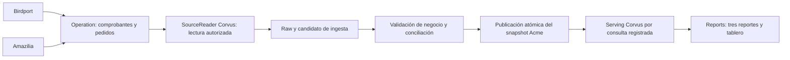

> Modelo vigente: `Tordo.SDK/rust/docs/analytics-product-model.md`. Este archivo conserva el reconocimiento y las métricas del ejemplo; la operación actual está en [runbook](runbook.md).

# Piloto Acme: Birdport y Amazilia → Corvus → Tordo.Reports

Fecha: 2026-10-30. Estado: ejemplo de datos sobre el modelo configurable de ingestas/BI; el componente de cliente del primer piloto fue retirado. Empresa: Acme DEV, código técnico `B20123456789`, base `20123456789_business`. La arquitectura objetivo se define en `Tordo.SDK/rust/docs/analytics-business-architecture.md` siguiendo Business/SDK.Business.

## Objetivo y alcance

Consolidar comprobantes comerciales de venta y pedidos de Acme, preparar un snapshot analítico consistente en Corvus y visualizar tres reportes en Reports. La facturación usa facturas y boletas como tipos distintos y filtrables; no se reduce a documentos fiscales tipo FACTURA.

Se recomienda incluir pedidos para explicar qué operaciones aún no tienen comprobante. El importe de pedido representa intención comercial y nunca se suma a lo facturado. Quedan fuera carritos, cotizaciones, pruebas técnicas de pago, direcciones, documentos personales, tokens, PDF/XML/CDR y detalle sensible de pasarelas.

## Reconocimiento de Acme DEV

Consulta de sólo lectura ejecutada el 2026-10-30 contra la base DEV; no se modificaron datos operativos.

| Observación | Resultado |
|---|---|
| Comprobantes de venta | Una BOLETA APPROVED, PEN 97.00, fecha comercial 2026-10-28 |
| Canal comprobado | Birdport, por vínculo del pedido con `ecommerce_order_meta` |
| Ambiente fiscal | BETA declarado en los metadatos Birdport |
| Líneas | Producto `TOC-CICA-CALMING-SERUM`: 89.00; servicio `BIRDPORT-DELIVERY`: 8.00 |
| Cuadre | Base 82.20 + impuesto 14.80 = 97.00; cabecera y líneas coinciden |
| Amazilia | No hay comprobantes existentes para este canal en el universo inspeccionado |
| Pedidos de Operation | 32, uno con comprobante aprobado vinculado |
| Metadatos ecommerce | 22 pedidos; 20 con `sandboxVerification=true`, uno entregado con boleta BETA y uno pendiente sin esa marca |
| Otros pedidos | Diez con `source_type=LIVE` y `source_name=BirdPort`; su clasificación como caso comercial o fixture requiere comprobación |
| Notas de crédito | Cero filas en el reconocimiento |

Los 31 pedidos sin comprobante no se anuncian como 31 oportunidades comerciales: el conjunto incluye fixtures y registros cuya clasificación está pendiente. Ausencia de una marca de fixture no acredita por sí sola que un registro represente una operación comercial real.

El registro de emisión de Operation aparece ACCEPTED, pero su campo `sunat_response_code` está vacío. No se inventa ese código a partir del estado ni de una evidencia antigua. Ambiente DEV, pago sandbox y emisión SUNAT BETA son dimensiones distintas.

## Autoridad y procedencia

Birdport y Amazilia usan Tordo.Operation para emitir el comprobante comercial. La extracción principal procede de `operation.sale_invoice` y `sale_invoice_line`, una vez por documento; no de dos copias publicadas por cada UI.

Los pedidos se extraen de `operation.sales_order`/`sales_order_line`. Birdport enriquece con `ecommerce.ecommerce_order_meta` y sus referencias de pago/facturación. El pago confirmado no se infiere de una factura y no es obligatorio copiar transacciones de pasarela para estos tres reportes.

La procedencia tendrá `sourceSystem=tordo.operation`, `originApplication`, `salesChannel`, `sourceOrderId`, `sourceInvoiceId`, `originEvidence` y `dataClassification`. Para Birdport se aprovechan los vínculos reales; ECOMMERCE y LIVE permanecen diferenciados.

Una factura no vinculada a Birdport no se atribuye automáticamente a Amazilia. Para los nuevos casos se debe persistir el origen en el backend a partir de contexto autorizado de aplicación/canal. El header o campo `originApplication` enviado libremente por un cliente no basta. El histórico sin evidencia conserva UNKNOWN hasta homologación.

Birdport crea ciertos pedidos directamente en su transacción sobre `operation.sales_order`; una futura captura de eventos debe cubrir también ese punto de escritura. Emitir eventos sólo desde los endpoints Operation dejaría un hueco.

## Primera entrega práctica: snapshots acotados

El primer recorrido hace una extracción explícita de sólo lectura desde la base Acme, con transacción REPEATABLE READ para cabeceras/líneas/pedidos/vínculos y enriquecimiento necesario. Se registra el corte de origen y la interpretación de fechas. El alcance temporal y el presupuesto son configuración aprobada del pipeline, no SQL/credenciales enviados por la UI.

La carga usa consultas acotadas dentro del mismo corte (máximo 5000 comprobantes/pedidos y 50000 líneas de cada clase; no hay paginación automática); si no puede completarse, el candidato falla y no sustituye al snapshot vigente. El identificador/hash de la carga permite repetir el envío sin multiplicar hechos. Repetir una extracción puede crear otra versión de snapshot, pero conserva las mismas identidades documentales.

Primero se prueban carga inicial, repetición y refresco explícito. El refresco periódico y la ingesta por eventos son entregas posteriores; este diseño no instala cron ni promete actualización en tiempo real.

## Modelo analítico

Todos los hechos tienen `tenantId`, `deploymentEnvironment`, `dataClassification`, `snapshotId`, referencias y versión de esquema. El manifiesto distingue fecha de captura, publicación y completitud acreditada.

| Conjunto | Grano y clave | Datos mínimos |
|---|---|---|
| `invoice_header` | Un comprobante por empresa/ambiente/id de origen | Número, tipo, fecha comercial, estado, moneda, base, impuesto, total, sucursal, canal y ambiente/estado fiscal conocido |
| `invoice_line` | Una línea por comprobante/id de línea de origen | Producto, unidad, cantidad, importes exactos y clase mercancía/envío/servicio |
| `order_header` | Un pedido por empresa/ambiente/id de origen | Registro, estado comercial, canal, importe/moneda y evidencia de clasificación |
| `order_line` | Una línea por pedido/id de origen | Producto, unidad, cantidad e importe; útil para futuras coberturas parciales |
| `order_invoice_link` | Un vínculo único pedido/comprobante | Referencia real de `sales_order_id`, estado del comprobante y evidencia de origen |
| `snapshot_manifest` | Un corte común | Conteos, controles, exclusiones, origen/contrato, versión y completitud |

No se usa serie/número como identidad única global ni se suma una cabecera después de unirla sin agregación a sus líneas. Un pedido puede tener varios comprobantes; una venta directa puede no tener pedido. No se deduce facturación parcial por coincidencia de SKU o importes.

## Políticas de cálculo y calidad

- Dinero/porcentajes/cantidades decimales exactos; moneda explícita. El legado SOL se homologa a PEN mediante regla documentada; otras monedas no se suman juntas.
- `invoice_date` se conserva como fecha comercial civil. Los timestamps sin zona del origen requieren una interpretación declarada/verificada; no se desplaza la fecha comercial al convertir UTC/Lima.
- Se muestran importes aprobados y vigentes al corte. CANCELLED se conserva como estado y no contribuye al agregado vigente. PENDING no es facturación emitida.
- Aprobación comercial y aceptación fiscal son filtros separados. BETA nunca se mezcla con producción ni se presenta como facturación real de producción.
- `sandboxVerification=true` se clasifica como prueba técnica y se excluye del análisis comercial. Los registros sin clasificación suficiente se muestran en calidad pendiente; la conversión no se certifica mientras afecten su denominador.
- Suma de base/impuesto/total de líneas concilia con su cabecera según reglas de redondeo del origen. No se recalcula IGV fijando 18 % ni se corrigen diferencias silenciosamente.
- El envío queda incluido en el total del comprobante y separado del ranking de mercancía por código/clasificación autorizada, no por coincidencia de texto del nombre.
- Los reportes iniciales son de facturación aprobada, no de ingreso contable reconocido, cobros o ventas netas de notas de crédito. Si aparecen notas de crédito, se conserva su existencia y se amplía el contrato antes de anunciar una métrica neta.

Una anomalía que comprometa importes, referencias o el corte común bloquea publicación. Una dimensión desconocida puede publicarse explícitamente como UNKNOWN con advertencia, sin reasignación inventada. El cálculo de conversión tiene su propio control de calidad.

## Serving y visualización

Corvus ofrece catálogo/manifiesto y ejecución de tres consultas registradas sobre un snapshot autorizado. Los resultados cumplen el contrato tabular: columnas ordenadas, filas posicionales, decimal exacto, cero filas con esquema, completitud, presupuesto, snapshotId y frescura.

Reports agrega un `DatasetBinding`/`CorvusServingAdapter` real. No se simula soporte Corvus cambiando el nombre de una conexión SQL operativa. Las conexiones PG/MySQL actuales siguen disponibles para otros usos.

Los tres reportes del tablero `Acme · Facturación y pedidos` se fijan al mismo snapshot. Cada tarjeta muestra tipo de documento, moneda, ambiente y fecha de datos. La UI puede seguir básica: barras, tabla, filtros de fecha/canal/tipo y descarga del resultado autorizado. Las definiciones concretas están en `Tordo.Reports/docs/acme-report-definitions.json`.

## Evolución incremental posterior

Las mutaciones confirmadas publicarán eventos analíticos mediante outbox en la misma transacción local del dueño. El consumidor Corvus tendrá inbox/deduplicación y versión por entidad; duplicados no multiplican ventas, revisiones antiguas no reemplazan nuevas y una respuesta perdida permite recuperar el resultado.

Se reutiliza el patrón de outbox existente, con despacho analítico independiente y trazable. No se adjunta Corvus como consumidor competidor a `sap_sync_queue`, ni se cambia el estado de entrega de eventos contables para considerar entregada una suscripción analítica. Cambios, cancelaciones, reclasificaciones y bajas lógicas requieren cobertura además de la creación inicial.

El punto de corte inicial/incremental debe acreditar que no pierde transacciones concurrentes. Ni `MAX(updated_at)`, ni la fecha del último mensaje, ni un contador asignado antes del commit bastan para esa garantía. La entrega incremental tendrá contrato y pruebas de checkpoint/replay propios antes de habilitarse.

## Orden de implementación y aceptación

1. Homologar la arquitectura Rust: contratos canónicos, puertos por capacidad, UoW/auditoría y publicación decidida por el caso de uso.
2. Construir el adaptador lector Acme y clasificar los registros existentes; preservar evidencia de fixtures y UNKNOWN.
3. Implementar proyecciones, controles y publicación de un snapshot común; probar rollback, repetición y alcance entre empresas.
4. Implementar serving Corvus y el binding Reports; crear las tres definiciones y un tablero básico.
5. Completar un caso DEV emitido realmente desde Amazilia y uno Birdport, más un pedido comercial todavía sin comprobante. No insertar facturas analíticas inventadas para llenar un gráfico.
6. Conciliar origen/Corvus/Reports por documento, tipo, canal, moneda e importes, incluyendo 97.00 = 89.00 + 8.00 para el caso Birdport existente.

La aceptación exige que los reintentos no cambien totales, los fixtures queden fuera, un documento sin canal conserve UNKNOWN, un snapshot incompleto no se publique y las tres tarjetas/exportaciones indiquen el mismo corte. Las pruebas de caída de Corvus/Reports no deben impedir emitir una venta operativa ni provocar fallback analítico al OLTP.

## Ejecución del piloto y límites actuales

Se creó una venta directa POS mediante el contrato autenticado `/operation/sale-invoice/checkout` consumido por Amazilia, con identidad temporal de operador DEV. No se automatizó la UI Flutter ni se fabricó un comprobante por SQL. La boleta aprobada es PEN89.00, una unidad del producto existente, en modalidad DEFERRED: no se generó cobro. Se usó una identidad de checkout estable y se comprobó el replay. El flujo operativo aplicó sus efectos normales de inventario/contabilidad y numeración; no se alteró PROD.

La atribución de ese caso a Amazilia se registra explícitamente en `analytics_export.origin_evidence`, con tipo de prueba, SHA-256 del recibo de operación y actor. Es evidencia gobernada para este piloto; no es autenticación automática de aplicación para futuras ventas. Los registros históricos sin prueba no se reclasifican por descarte. El lector de Corvus no puede leer ni modificar esa tabla.

El primer corte real contiene dos boletas aprobadas y tres líneas: Birdport97.00 (producto89.00 + envío8.00) y Amazilia89.00 (producto89.00), total PEN186.00. Los32 pedidos existentes se preservan:20 fixtures excluidos,10 pendientes de clasificación,1 comercial con comprobante y1 sin comprobante. La venta POS directa no entra en el denominador de pedidos. La tasa queda NULL.

El corte se lee en REPEATABLE READ READ ONLY. También se incluyen comprobantes vinculados al conjunto de pedidos aunque su fecha fiscal esté fuera del período, para que la cobertura no signifique sólo comprobantes del mismo mes. Las consultas de facturación filtran por fecha de comprobante; las de cobertura, por fecha del pedido. Los filtros no pueden exceder la ventana declarada del snapshot. Los reportes de comprobantes exigen ambiente fiscal explícito; la pantalla del piloto usa BETA.

Tablas `corvus.sales_*`, cabeceras/líneas y vínculos contienen ámbito de empresa. El core valida decimales sin redondeo, referencias, identidades, conciliación de cada línea y cabecera, moneda y clasificación. Publicar graba hechos, manifiesto, puntero vigente, checkpoint y auditoría en una transacción. Un fallo conserva el corte anterior. Una identidad de ingesta compatible devuelve su manifiesto; otra solicitud bajo la misma identidad falla. Una nueva identidad produce una nueva versión, sin acumular importes entre snapshots.

Rutas Corvus: POST `/api/v1/sales/ingestions`, GET `/api/v1/sales/dataset`, POST `/api/v1/sales/query`. Se mantienen las rutas anteriores de lotes/eventos. Capacidad `corvus:ingest` para extracción y `corvus:query` para serving. Reports sólo posee esta última en su conexión de Acme.

La UI Corvus permite extraer/publicar o consultar vigente; la UI Reports muestra tres tarjetas, tablas/barras, período, moneda/aplicación y evidencia de corte común. Exportaciones autorizadas CSV/XLSX conservan decimales exactos. No hay fallback OLTP, cron, delta/CDC, consumidores de SAP, Parquet, workers ni emisión fiscal automática por Corvus.

Evidencia: `docs/evidence/acme-pos-case.json`, `acme-pilot-acceptance.json` y `acme-ui-acceptance.json`. Procedimiento reproducible: [runbook](acme-pilot-runbook.md).
